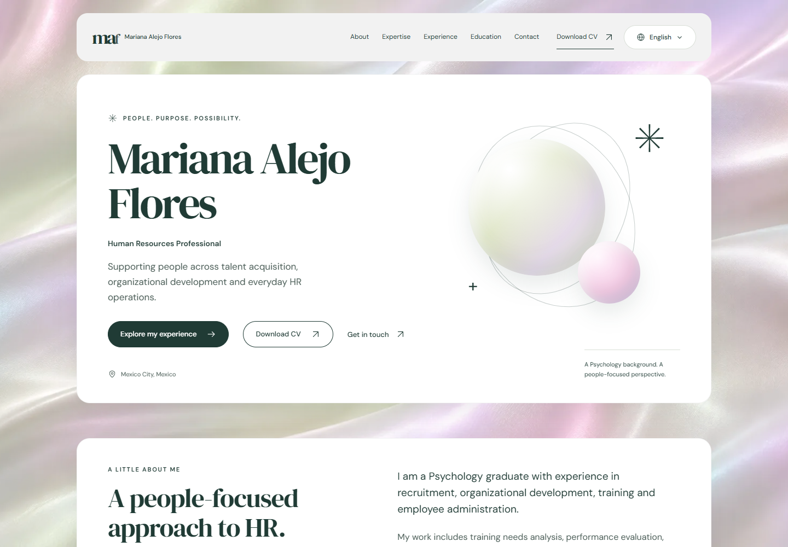
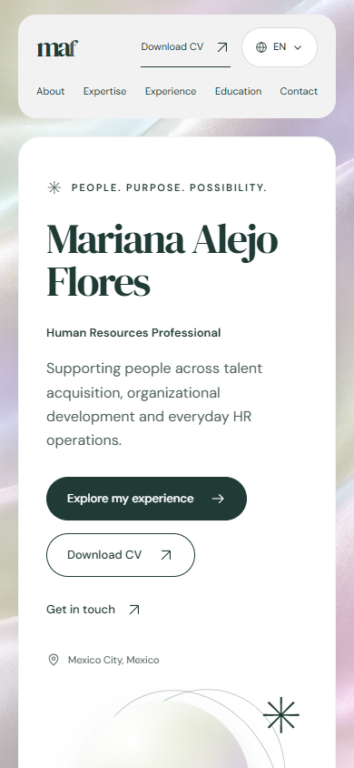
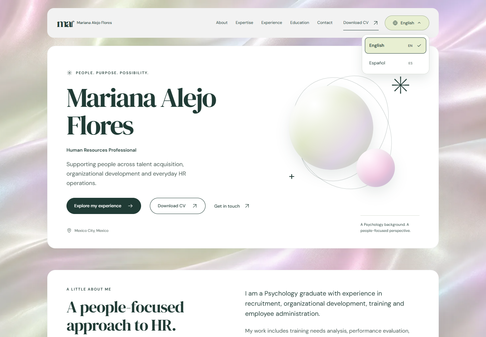
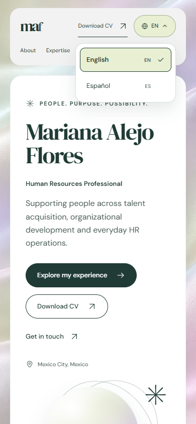
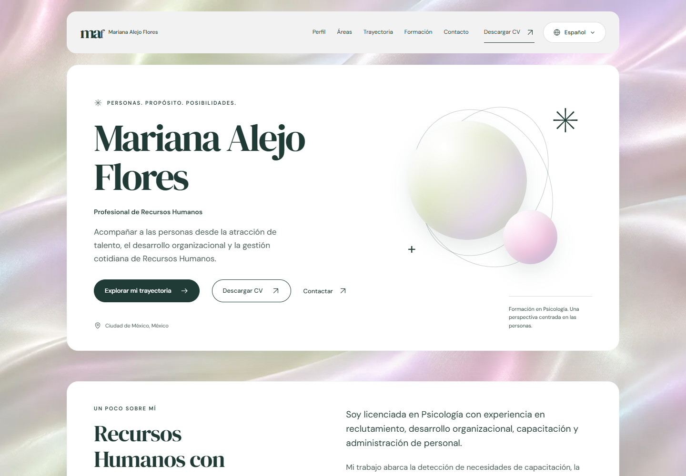
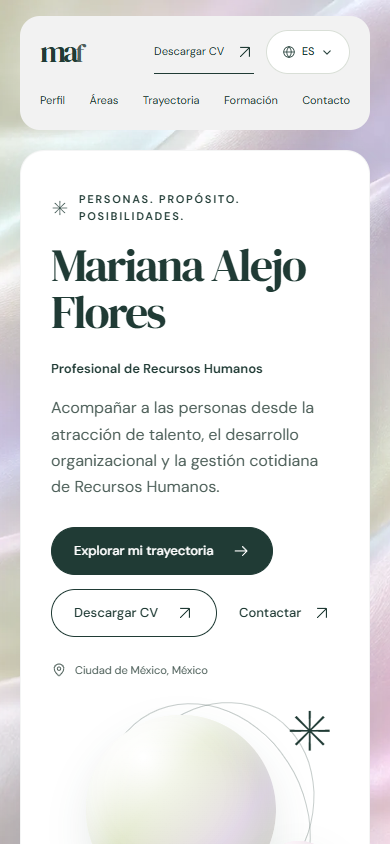
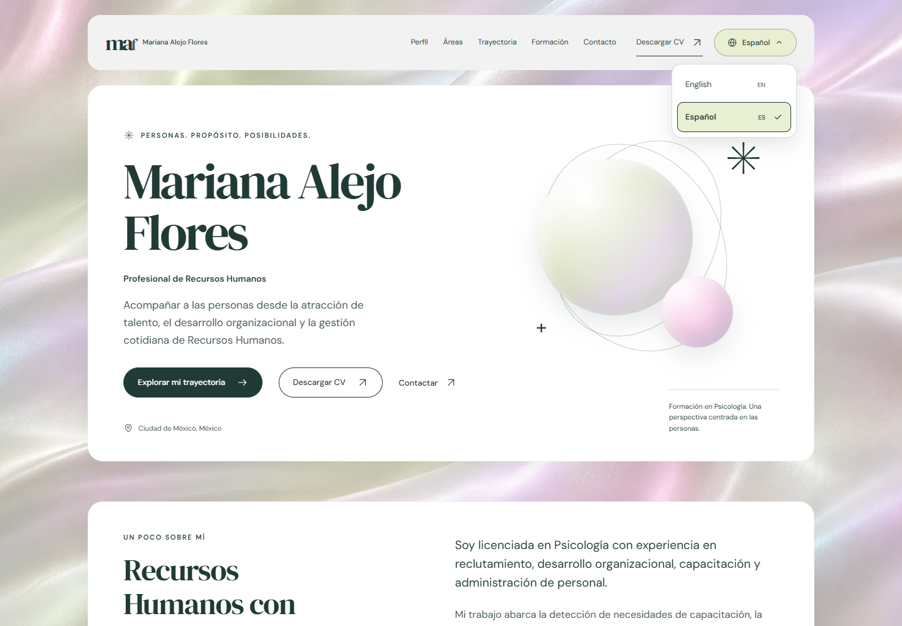
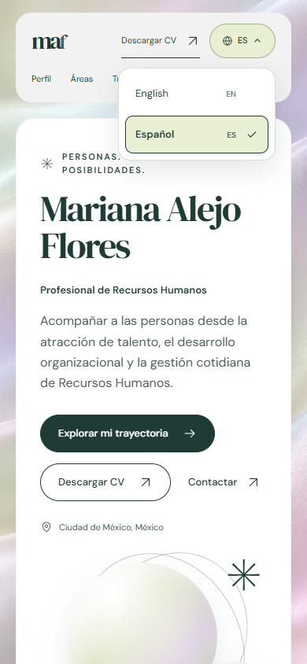

# Mariana Alejo Flores

A professional Human Resources portfolio built with Astro. It presents experience, areas of expertise, education, professional development, tools, and contact information in an accessible, responsive editorial interface.

## Screenshots

The final bilingual screenshots below are from [`docs/screenshots/i18n-final-2026-11-03/`](./docs/screenshots/i18n-final-2026-11-03/).

| View | Desktop | Mobile |
| --- | --- | --- |
| English |  |  |
| English, language menu open |  |  |
| Spanish |  |  |
| Spanish, language menu open |  |  |

## Features

- Professional content in English (`/`) and Spanish (`/es/`), with the same 128 translation keys and interpolations, validated before every build.
- Section navigation covering profile, expertise, experience, education, professional development, tools, methods, languages, and contact.
- Downloadable bilingual CV, preserving the original document.
- Responsive design with local fonts and a pearlescent texture optimized for desktop and mobile.
- A language menu styled to match the pearlescent editorial design, with keyboard navigation, touch selection, and preservation of URL fragments and query parameters.
- Content, navigation, expandable sections, and downloads work without JavaScript. Language switching retains EN/ES links, while JavaScript enhances the selector, lighting effects, and email copying.
- Accessibility support through keyboard navigation, a skip link, visible focus indicators, and Axe WCAG A/AA checks.
- Respects `prefers-reduced-motion` and avoids requests to external font services.

## Technology

- [Astro](https://astro.build/) with static output
- TypeScript and content validation
- Node.js Test Runner and Playwright
- Fontsource: DM Sans and DM Serif Display

## Local development

Requires Node.js `>=22.23.4`.

```sh
npm ci
npm run dev -- --background
```

Manage the background development server with:

```sh
npm run astro -- dev status
npm run astro -- dev logs
npm run astro -- dev stop
```

## Verification

```sh
npm run check
npm test
npm run build
```

To check the static build with browser tests:

```sh
npm run serve:build
```

In another terminal:

```sh
npm run test:e2e
```

The build server runs at `http://127.0.0.1:4322`. Browser tests use Microsoft Edge in headless mode and also cover an emulated mobile viewport. Set `TEST_BASE_URL` to target a different local URL.

## Screenshot archive

The five original screenshots are archived unchanged in `docs/screenshots/before-i18n-2026-11-03/`. Bilingual screenshot sets are stored separately; see the [screenshot index](./docs/screenshots/README.md). The set displayed above includes English and Spanish desktop and mobile views, with the language menu closed and open.

With the build server running, create a new set without overwriting previous captures:

```sh
npm run capture -- unique-revision-name
```

Each set includes a SHA-256 manifest. The command rejects names that have already been used.

## Project structure

```text
src/
  components/  Editorial components and sections
  content/     Data, translations, schema, and validation
  i18n/        Language registry, localized formatting, and navigation
  layouts/     Global page structure
  styles/      Design tokens and responsive styles
  views/       Portfolio composition
public/
  images/      Optimized site textures
  resume/      Downloadable bilingual CV
tests/         Unit and integration tests
docs/          Content guides and source decisions
```

## Content and deployment

Read the [content update guide](./docs/content-guide.md) before changing experience, education, contact information, or the CV. Content provenance and presentation decisions are documented in [sources and editorial decisions](./docs/source-decisions.md); the latest local checks are recorded in the [verification report](./docs/verification.md).

The project does not declare a domain or use a placeholder canonical URL. Once a domain is available, set `SITE_URL` before building to generate canonical tags and `og:url`.

Alternate `hreflang` links are also generated using that domain. Spanish content uses Mexican date and number formats. Error pages share the same layout and are available in both languages; production error routing depends on the chosen hosting provider.
